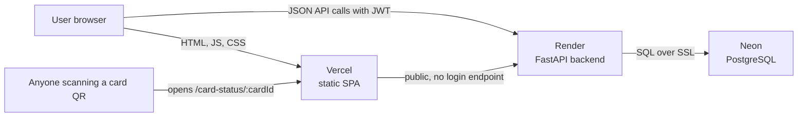
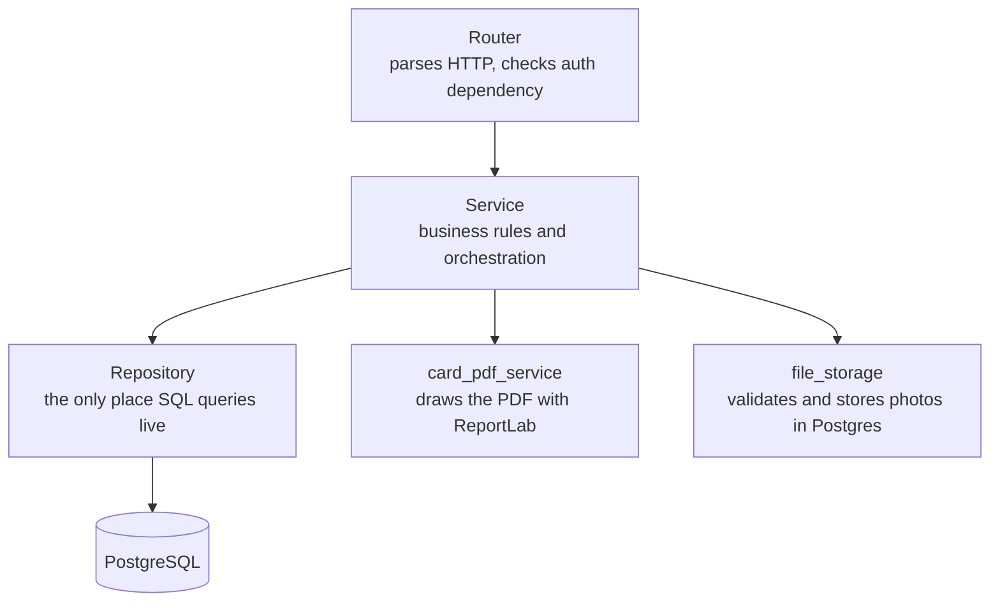
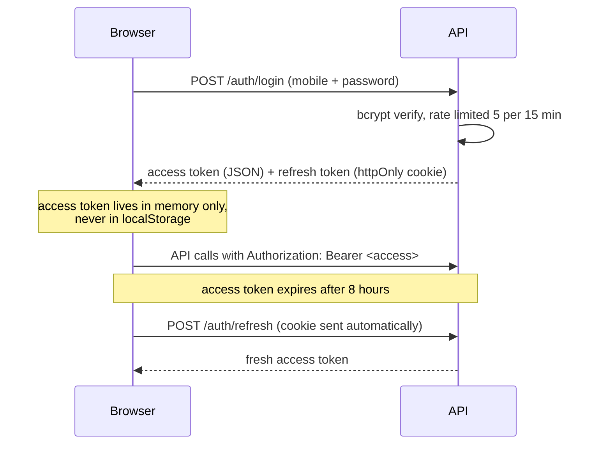
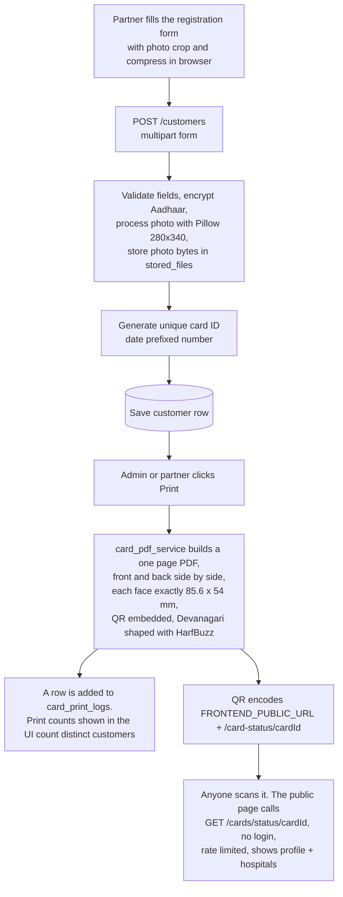
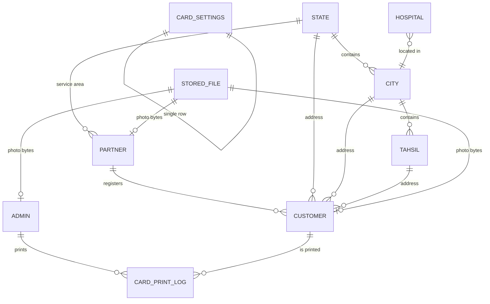
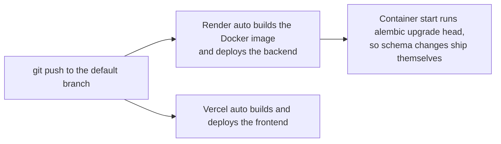

# Jan Kalyan Health Card. Migration and Deployment Guide

This document is written for the teammate who is taking over this project. If you have the codebase and the environment values from us, this guide is everything you need to deploy the database, the backend, and the frontend on your own accounts, and to understand how the whole system works.

Read it top to bottom once, then follow the steps in order. Nothing here is optional unless it is clearly marked as optional.

---

## 1. What this project is

Jan Kalyan Health Card is a hospital discount card platform.

* Field **partners** log in and register customers. Each customer gets a server generated card ID and a printable PDF health card with a QR code.
* A **super admin** manages partners, customers, hospitals, locations (state, city, tahsil), card settings, and printing reports.
* Anyone who **scans the QR** on a printed card lands on a public page (no login) that shows the card holder profile, validity, and the list of empanelled hospitals.

## 2. The three deployed pieces

| Piece | Technology | Where it runs | What it serves |
|---|---|---|---|
| Frontend | React 19, Vite, TypeScript, Tailwind v4 | Vercel | The static single page app at `https://jankalyanhealthcard.com` |
| Backend | FastAPI, Python 3.12, SQLAlchemy 2, Alembic | Render (Docker web service) | The JSON API at `https://<your-service>.onrender.com/api/v1`, plus `/health` and `/storage/photos/...` |
| Database | PostgreSQL 16 | Neon | All data, including customer photos (stored as bytes in the `stored_files` table, not on disk) |

How they connect:



One important design fact before you deploy: the backend has **no persistent disk requirement**. Customer photos live inside Postgres and PDFs are generated in memory and streamed, never saved. This is deliberate, because Render free tier wipes the container filesystem on every restart. It means the only stateful piece you must protect is the database.

## 3. What you need from us before starting

Ask us for these values. Everything else you will generate fresh on your own accounts.

1. The Git repository (or a copy of the codebase).
2. The current production environment values, specifically:
   * `AADHAAR_ENCRYPTION_KEY` **(critical, read the warning below)**
   * The current `DATABASE_URL` (only needed if you are migrating existing data)
3. A database dump, or temporary access to the old database so you can take one yourself.

**Warning about `AADHAAR_ENCRYPTION_KEY`:** customer Aadhaar numbers are encrypted at rest with AES 256 GCM using this key. If you are migrating existing data, you **must** reuse the exact same key, otherwise every already stored Aadhaar number becomes permanently unreadable. If you are starting with an empty database instead, generate a brand new key and never share it.

JWT secrets do **not** need to be copied. Generate new ones. The only consequence is that every user has to log in again, which is fine for a migration.

Generate fresh secrets with this one liner (needs Python installed):

```bash
python -c "import secrets, base64; print('JWT_ACCESS_SECRET=' + secrets.token_hex(32)); print('JWT_REFRESH_SECRET=' + secrets.token_hex(32)); print('AADHAAR_ENCRYPTION_KEY=' + base64.b64encode(secrets.token_bytes(32)).decode())"
```

## 4. Regions. Decide this first

Latency between the backend and the database matters far more than latency between the user and the backend, because a single API request can make several database round trips. So the rule is simple:

**Put Render and Neon in the same region.** The users are in India, so pick **Singapore** for both:

* Neon region: **AWS Asia Pacific (Singapore), ap-southeast-1**
* Render region: **Singapore**

Vercel serves static files from a global CDN so its region barely matters. Leave it on the default.

## 5. Step by step. Database on Neon

1. Create an account at `https://neon.tech` and create a new project.
2. During project creation choose:
   * Postgres version: **16**
   * Region: **AWS ap-southeast-1 (Singapore)**
3. When the project is created, open the dashboard and copy the **connection string**. It looks like this:

```
postgresql://<user>:<password>@<endpoint>.ap-southeast-1.aws.neon.tech/<dbname>?sslmode=require
```

Keep `sslmode=require` in the string. Neon refuses non SSL connections.

You do not need to hand edit the URL scheme. The backend automatically rewrites `postgres://` or `postgresql://` to the `postgresql+psycopg2://` form that SQLAlchemy needs (see `backend/app/core/config.py`, `_normalize_database_url`).

### 5a. If you are starting with an EMPTY database

Do nothing else here. The backend container runs `alembic upgrade head` on every start, which creates all tables (there are 10 migrations), and then runs `python -m scripts.ensure_admin`, which creates the bootstrap admin login if it does not exist:

* Mobile: `9584028379`
* Password: `Admin@123`

**Log in and change this password immediately after your first deploy.**

### 5b. If you are MIGRATING the existing data

Take a dump from the old database and restore it into Neon. You need the `pg_dump` and `pg_restore` tools (they come with any Postgres install; version 16 or newer).

```bash
# 1. Dump the old database (ask us for the old DATABASE_URL)
pg_dump "OLD_DATABASE_URL" --no-owner --no-privileges -Fc -f janarogya.dump

# 2. Restore into the new Neon database
pg_restore --no-owner --no-privileges -d "NEW_NEON_CONNECTION_STRING" janarogya.dump
```

Notes:

* `--no-owner --no-privileges` avoids errors caused by role names that exist on the old server but not on Neon.
* The dump includes the `alembic_version` table, so the backend knows the schema is already up to date and will not try to recreate anything.
* The dump also includes the `stored_files` table, which carries all customer photos. Nothing else needs to be copied for photos to survive the move.
* After restoring, remember that migrated admin and partner accounts keep their existing passwords, and Aadhaar decryption only works if you reused our `AADHAAR_ENCRYPTION_KEY` (section 3).

## 6. Step by step. Backend on Render

The backend deploys as a **Docker** web service. The Dockerfile is at `backend/Dockerfile` and its start command already does the right thing in the right order: run migrations, ensure the bootstrap admin, start the API.

1. Create an account at `https://render.com`.
2. Connect your GitHub account and give Render access to the repository. If the repo is private, GitHub will ask you to grant the Render app permission for that specific repo. If Render later says it cannot clone the repo, this permission is what is missing (GitHub, Settings, Applications, Render, Repository access).
3. Click **New**, then **Web Service**, and pick the repository.
4. Configure the service:

| Setting | Value |
|---|---|
| Language / runtime | **Docker** |
| Root Directory | `backend` |
| Region | **Singapore** |
| Branch | your default branch |
| Health Check Path | `/health` |
| Instance type | Free (or paid if you want to avoid cold starts entirely) |

5. Add the environment variables. This is the complete list the app reads (defined in `backend/app/core/config.py`). Values marked required have no safe default.

| Variable | Required | Value |
|---|---|---|
| `DATABASE_URL` | yes | The Neon connection string from step 5 |
| `JWT_ACCESS_SECRET` | yes | Freshly generated 64 char hex (section 3) |
| `JWT_REFRESH_SECRET` | yes | Freshly generated, different from the access secret |
| `AADHAAR_ENCRYPTION_KEY` | yes | Ours if migrating data, fresh if starting empty |
| `ENVIRONMENT` | yes | `production` |
| `BACKEND_BASE_URL` | yes | The public URL of this very service, for example `https://your-api.onrender.com`. Used to build customer photo URLs. If you forget it, photos will 404 in the browser and the logs will print a loud warning at startup. |
| `FRONTEND_PUBLIC_URL` | yes | The final site URL, for example `https://jankalyanhealthcard.com`. Used for QR deep links, and automatically added to the CORS allow list so the site can call the API. |
| `CORS_ORIGINS` | no | Comma separated extra origins. `FRONTEND_PUBLIC_URL` is always included automatically, so you only need this if the site is reachable on more than one origin (for example both the apex domain and a `www` subdomain). |
| `JWT_ACCESS_EXPIRES_MINUTES` | no | Default `480` |
| `JWT_REFRESH_EXPIRES_DAYS` | no | Default `30` |
| `MAX_PHOTO_SIZE_MB` | no | Default `2` |
| `LOGIN_RATE_LIMIT` | no | Default `5/15minutes` |
| `PUBLIC_CARD_RATE_LIMIT` | no | Default `200/minute` |
| `ORGANIZATION_NAME` | no | Default `Jan Kalyan Health Card` |
| `CARD_TAGLINE` | no | Default is the Hindi tagline printed on the card |
| `CARD_DISCLAIMER_NOTE` | no | Default is the Hindi disclaimer, and it only seeds the first `card_settings` row. After that the admin edits it from the Card Settings page. |

A chicken and egg note: at this moment you may not know the final frontend URL yet. Deploy with a placeholder (`http://localhost:5173`), finish step 7, then come back and set `FRONTEND_PUBLIC_URL` correctly and let Render redeploy. Login from the browser will not work until this value matches the real site origin, because the browser blocks the response under CORS rules.

6. Click deploy and watch the logs. A healthy first boot prints the Alembic migration output, then either `Created bootstrap admin (9584028379).` or a message saying it already exists, then Uvicorn starting on port 8000.

7. Verify from your machine:

```bash
curl https://your-api.onrender.com/health
# expected: {"status":"ok"}
```

Interactive API docs are available at `https://your-api.onrender.com/docs`.

### 6a. Keeping the free instance awake

Render free tier puts the service to sleep after roughly 15 minutes without traffic, and the next visitor then waits about 50 seconds for a cold start. This repo already contains the fix: `.github/workflows/keep-alive.yml` is a GitHub Actions cron job that pings `/health` every 10 minutes.

Two things you must do for it to work on your fork:

1. Edit the URL inside the workflow file so it points at **your** Render service, not ours.
2. Make sure the workflow file exists on your repository **default branch**, because GitHub only runs scheduled workflows from there.

Know the limits: GitHub pauses scheduled workflows after about 60 days without any commits to the repo (a single push turns them back on), and Render free tier includes 750 instance hours per month, which covers exactly one always awake service.

## 7. Step by step. Frontend on Vercel

1. Create an account at `https://vercel.com` and import the Git repository as a new project.
2. Configure the project. The one setting people get wrong is the root directory:

| Setting | Value |
|---|---|
| Root Directory | `frontend` **(critical, the repo is a monorepo)** |
| Framework preset | Vite |
| Build command | `npm run build` (already declared in `frontend/vercel.json`) |
| Output directory | `dist` (already declared in `frontend/vercel.json`) |

`frontend/vercel.json` also contains the SPA rewrite (`/(.*)` to `/index.html`) so that deep links like `/card-status/12345` load correctly on refresh. You do not need to touch it.

3. Add the single frontend environment variable, for the **Production** environment:

| Variable | Value |
|---|---|
| `VITE_API_BASE_URL` | `https://your-api.onrender.com/api/v1` |

Note the `/api/v1` suffix. The value is baked into the JS bundle at build time, so if you ever change it you must trigger a new deployment for it to take effect.

4. Deploy. Verify the preview URL loads the login page.

5. Attach the custom domain. In the Vercel project, open Settings, then Domains, and add your domain (for example `jankalyanhealthcard.com`). Vercel shows you exactly which DNS records to create at your registrar:
   * Apex domain: an `A` record pointing to Vercel's IP (Vercel shows the current value on that screen).
   * `www` subdomain: a `CNAME` record pointing to `cname.vercel-dns.com`.

   Wait for DNS to propagate and for Vercel to issue the SSL certificate (usually minutes).

6. Now go back to Render and set `FRONTEND_PUBLIC_URL=https://your-domain.com` (and add the `www` variant to `CORS_ORIGINS` if you kept it). Let the backend redeploy. This is the moment login from the real site starts working.

Two Vercel gotchas we hit ourselves, so you do not have to:

* **CLI deploys**: if you deploy with the `vercel` CLI instead of Git pushes, run it from the **repo root**, not from inside `frontend`. Since the project root directory is set to `frontend`, running the CLI inside that folder makes Vercel look for `frontend/frontend` and fail.
* **Unverified commit email**: Vercel refuses to build commits whose Git author email is not attached to your GitHub account. If a deployment is skipped with that message, run `git config user.email "your-github-email"` and push a new commit.

## 8. Final verification checklist

Go through this list in order after everything is deployed. Each item catches a different class of mistake.

1. `curl https://your-api.onrender.com/health` returns `{"status":"ok"}`.
2. The site loads on your domain, over HTTPS.
3. Admin login works (`/admin/login`, bootstrap credentials from section 5a, or the migrated account). If the request fails in the browser but succeeds in `curl`, that is CORS, so recheck `FRONTEND_PUBLIC_URL` on Render.
4. Change the bootstrap admin password from the admin Profile page.
5. Create a test partner (with a profile photo, which also proves photo upload and photo serving work end to end).
6. Log in as that partner and register a test customer with a photo.
7. Open the customer and export the card PDF. Both card faces must appear side by side on one page with the photo, the QR, and Hindi text rendering correctly.
8. Scan the QR from the printed PDF with a phone. It must open the public card status page on your domain and show the customer profile. This proves `FRONTEND_PUBLIC_URL` is right, because the QR target URL is built from it.
9. Delete the test customer and partner.
10. Wait 20 minutes without touching the site, then load it again. If the first API call is instant, the keep alive ping is doing its job (check the Actions tab on GitHub for green runs).

## 9. Problems we already solved once, so check here first

| Symptom | Cause | Fix |
|---|---|---|
| Login returns a network or CORS error in the browser, but the API works in curl | The browser origin is not in the CORS allow list | Set `FRONTEND_PUBLIC_URL` on Render to the exact site origin, no trailing slash |
| Customer photos upload fine but show broken images | `BACKEND_BASE_URL` still points at localhost | Set it to the Render service public URL |
| First request after a quiet period takes about a minute | Free instance was asleep | Confirm the workflow in `.github/workflows/keep-alive.yml` runs on the default branch and points at your URL |
| Render says it cannot clone the repository | The Render GitHub app has no access to the (private) repo | GitHub, Settings, Applications, Render, grant repository access, then redeploy |
| Vercel build error saying `frontend/frontend` does not exist | CLI deploy started from inside the `frontend` folder | Deploy from the repo root, or push through Git |
| Vercel skips the deployment due to an unverified commit email | Commit author email not linked to the GitHub account | Fix `git config user.email` and push again |
| Aadhaar numbers unreadable after migration | New `AADHAAR_ENCRYPTION_KEY` with old data | Restore our original key |

---

# Part 2. How the project works

This half explains the codebase so you can maintain it, not just run it.

## 10. Repository layout

```
Arogya/
  backend/
    app/
      core/          config, security (JWT + bcrypt), Aadhaar crypto, rate limiting,
                     file storage, exceptions, logging
      db/            SQLAlchemy engine and session factory
      models/        ORM tables: Admin, Partner, Customer, Hospital, State/City/Tahsil,
                     CardSettings, CardPrintLog, StoredFile
      schemas/       Pydantic request and response contracts
      repositories/  the ONLY layer that writes SQL queries
      services/      business rules: auth, customers, partners, cards, PDF drawing
      api/v1/routers/ thin HTTP endpoints, one file per resource
      main.py        app assembly, CORS, error envelope, /health, /storage photos
    alembic/         10 schema migrations, run automatically at container start
    scripts/         ensure_admin.py (bootstrap login), seed.py (dev demo data only)
    tests/           pytest suite, runs against in memory SQLite, no Postgres needed
    Dockerfile       the image Render builds and runs
  frontend/
    src/
      app/           router, route guards, query client, session bootstrap
      pages/         one file per screen, admin screens under pages/admin/
      components/    ui/ design system primitives, layout/ shells, card/ the card faces
      api/           typed API client modules (axios)
      store/         Zustand stores: auth session, toasts
      hooks/         data hooks (locations, brand config, debounce, printing)
      lib/           date formatting, image crop, env, helpers
    vercel.json      build config plus the SPA rewrite
  .github/workflows/keep-alive.yml   the Render anti sleep ping
  docker-compose.yml                 local dev Postgres only, not used in production
```

## 11. Backend architecture

The backend is layered strictly. A request always flows in one direction and each layer has one job:



Rules that keep the codebase safe, and that you should preserve when changing it:

* Routers never touch the database directly. They validate input with Pydantic schemas, call one service function, and shape the response.
* Every customer query in the repository layer is **partner scoped**. There is deliberately no method that returns customers without a `partner_id` filter, so one partner can never read another partner's customers. A guardrail test in `tests/test_card_logic.py` enforces this.
* All errors become one JSON envelope: `{success, error, message, fields}`. The handlers in `main.py` catch app errors, validation errors, rate limits, and unexpected exceptions, so the frontend can always parse what it receives.
* Aadhaar numbers are encrypted before they reach the database, and only the last 4 digits are ever returned by any API.

### Authentication

Two separate identities exist, partner and admin, each with its own login endpoint, its own refresh cookie, and its own route guard on the frontend.



Admin endpoints live under `/api/v1/admin/...` and use `/api/v1/admin/auth/login`. On page refresh the frontend calls the refresh endpoint first (`useSessionBootstrap`) to silently restore the session.

### The card flow, from registration to a scanned QR



Details worth knowing:

* The PDF is drawn twice in the codebase on purpose: once in Python (`backend/app/services/card_pdf_service.py`) for the export, and once in React (`frontend/src/components/card/CardFront.tsx` and `CardBack.tsx`) for the live preview. The two share the same geometry constants, so **any visual change must be made in both places** or the preview and the print will drift apart.
* Hindi text in the PDF is shaped with HarfBuzz because ReportLab alone cannot render Devanagari conjuncts correctly. Latin fragments inside Hindi strings fall back to Helvetica.
* Batch printing (admin selects up to 20 customers) produces one A4 PDF with 4 cards per page through the same drawing code.
* Card branding is split in two: static values (tagline, organization name) come from environment variables, while admin editable values (helpline, fee, facilities list, disclaimer) live in the `card_settings` database row and are edited on the admin Card Settings page. The frontend preview reads both through `GET /cards/brand-config`, so preview and print always agree.

### Data model



* `customers` uses soft delete (a deleted flag), so card IDs are never reused.
* `card_print_logs` is append only. One row per print action, and the UI aggregates with distinct customer counts, so reprinting the same card does not inflate the numbers.
* `stored_files` holds the actual JPEG bytes for every uploaded photo, keyed by a `photos/<uuid>.jpg` string that the photo columns reference. `GET /storage/photos/<filename>` serves them.

## 12. Frontend architecture

* **Routing**: `src/app/AppRoutes.tsx`. Three route families: public (`/login`, `/admin/login`, `/card-status/:cardId`), partner (`/app/...` behind a partner guard), and admin (`/admin/...` behind an admin guard). Guards live in `src/app/guards.tsx`.
* **Server state**: TanStack Query. Every API resource has a typed module in `src/api/` and screens consume them through `useQuery` and `useMutation`. After a mutation the affected query keys are invalidated, so the UI refreshes itself.
* **Client state**: Zustand, and only two stores: the auth session (`store/authStore.ts`, holds the in memory access token) and toasts.
* **Photo pipeline in the browser**: `components/ui/PhotoUpload.tsx` opens `PhotoCropModal` (interactive crop with zoom and rotation, built on `react-easy-crop`), then `lib/imageCrop.ts` applies the rotation and crop on a canvas and compresses the result before upload. The server then validates and encodes it again on its own, so nothing depends on the client behaving.
* **Dates**: everything displays as `DD-MM-YYYY` (Indian format) through the helpers in `lib/date.ts`, while the API always speaks ISO `YYYY-MM-DD`. Keep that separation.
* **Card preview**: `components/card/CardFront.tsx` and `CardBack.tsx` are pixel mirrors of the PDF, as explained in section 11.

## 13. Local development, in case you need to debug before deploying

```bash
# database (Docker), listens on host port 5433
docker compose up -d postgres

# backend
cd backend
python -m venv .venv && .venv\Scripts\activate     # Windows
pip install -r requirements.txt
copy .env.example .env                              # then fill the three secrets
python -m alembic upgrade head
python -m scripts.seed                              # dev demo data + demo logins
uvicorn app.main:app --reload                       # http://localhost:8000/docs

# frontend, in a second terminal
cd frontend
npm install
copy .env.example .env                              # points at http://localhost:8000/api/v1
npm run dev                                         # http://localhost:5173
```

Tests: `python -m pytest` inside `backend/`. The suite uses in memory SQLite, so it runs without Postgres. Frontend type checking and build: `npm run build` inside `frontend/`.

One Windows specific warning from our own experience: Docker Desktop on Windows with WSL2 sometimes breaks host to container Postgres connections (password failures or dropped connections that make no sense). If that happens to you, it is not the code. Run the backend inside Docker on the same network as Postgres, or use a non Docker Postgres install locally.

## 14. Deployment flow after the migration, day to day



That is the whole release process. Push to the default branch, and both platforms deploy automatically. Database schema changes travel as Alembic migration files inside the same push and apply themselves at the next backend start. There is no manual migration step in production.
